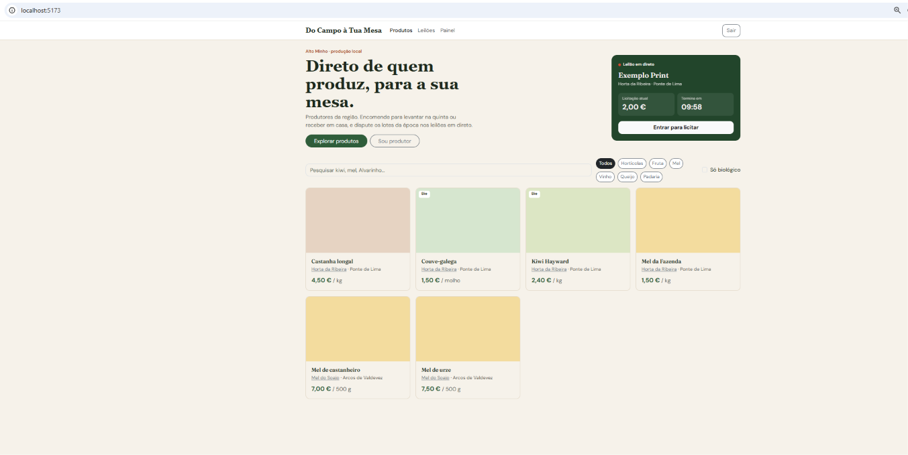
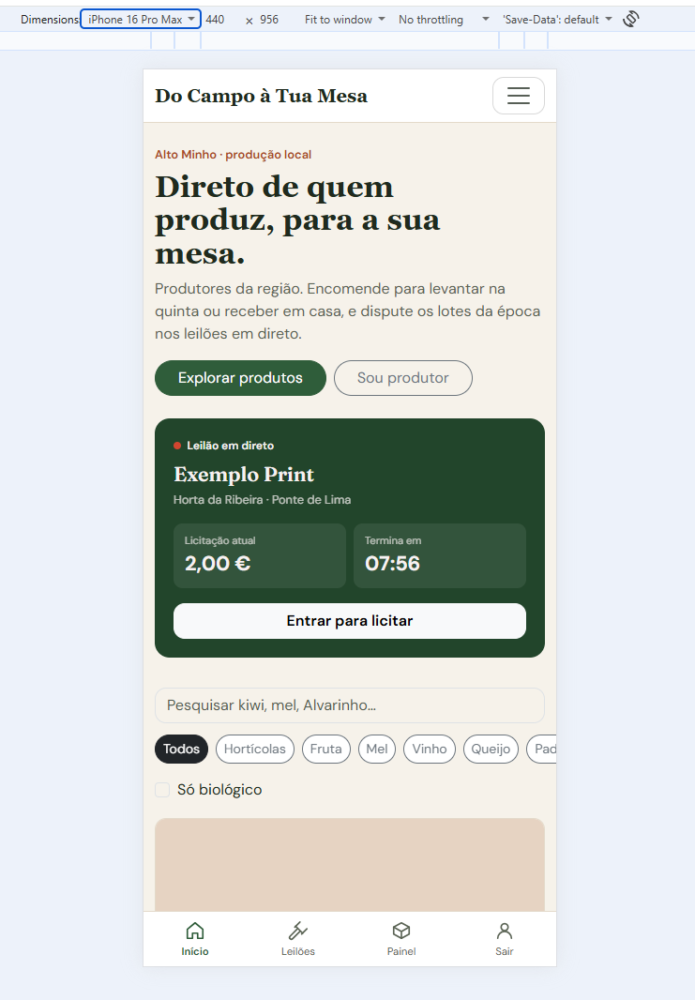
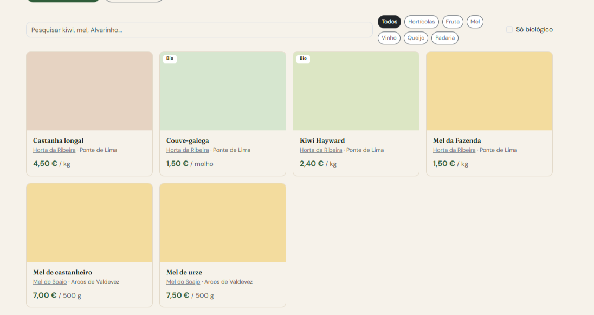
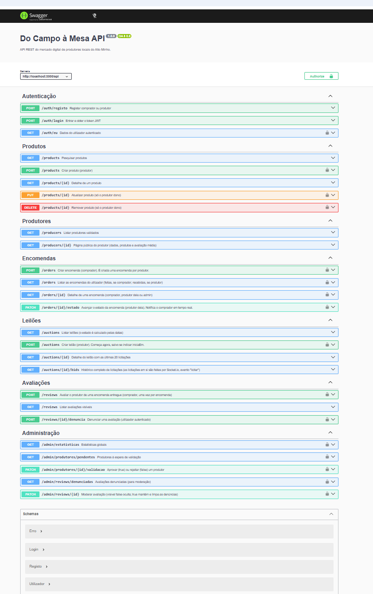
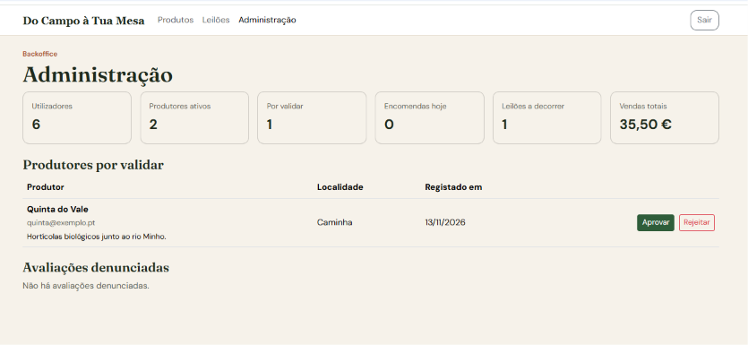
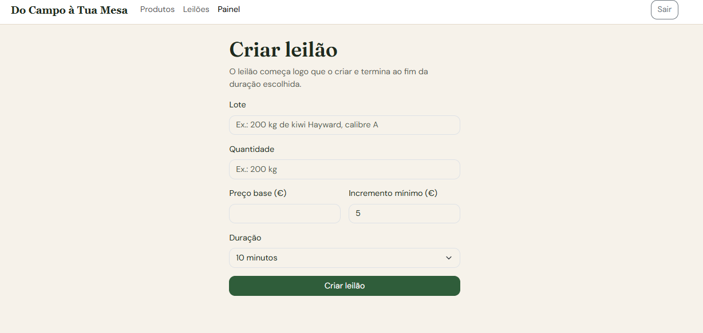

# Do Campo à Tua Mesa

Mercado digital de produtores locais do Alto Minho: os compradores (particulares / restaurantes) encomendam diretamente aos produtores e disputam os lotes da época em **leilões em direto**.

Trabalho prático individual de **Desenvolvimento Web e para a Cloud** · Mestrado em Engenharia Informática · IPVC-ESTG · 2026
**Autora:** Mariana Almeida de Oliveira - 31207
**Repositório:**  https://github.com/marianaalmeida01/mei31207_marianaalmeida_campoamesa

---

## Índice

0. [Como executar](#0-como-executar)
1. [Introdução](#1-introdução)
2. [Arquitetura](#2-arquitetura)
3. [Frontend e SPA](#3-frontend-e-spa)
4. [API REST e documentação](#4-api-rest-e-documentação)
5. [Modelo de dados](#5-modelo-de-dados)
6. [Segurança](#6-segurança)
7. [Tempo real e consistência dos leilões](#7-tempo-real-e-consistência-dos-leilões)
8. [Deployment na Cloud](#8-deployment-na-cloud)
9. [Dificuldades e trabalho futuro](#9-dificuldades-e-trabalho-futuro)
10. [Declaração de uso de ferramentas](#10-declaração-de-uso-de-ferramentas)
- [Anexo A: Testes realizados](#anexo-a-testes-realizados)

---

## 0. Como executar

**Requisitos:** Node.js 20 ou superior e uma base de dados MongoDB (local ou MongoDB Atlas).

```bash
# 1) API
cd api
cp .env.example .env      # preencher MONGODB_URI e JWT_SECRET
npm install
npm run seed              # dados de exemplo (APAGA utilizadores, produtos e leilões)
npm run dev               # http://localhost:3000  ·  documentação em /api-docs

# 2) SPA (noutro terminal)
cd web
cp .env.example .env      # VITE_USAR_DADOS_SIMULADOS=false para usar a API
npm install
npm run dev               # http://localhost:5173
```

**Contas de teste** (criadas pelo `npm run seed`; password de todas: `password123`):

| Papel | Email |
|---|---|
| Administrador | admin@exemplo.pt |
| Produtor | horta@exemplo.pt |
| Produtor | mel@exemplo.pt |
| Comprador | tasca@exemplo.pt |
| Mariana Almeida | marianaalmeidaufba@gmail.com |

O ficheiro `.env` (com a ligação à base de dados e o segredo do JWT) **não está no repositório**: está no `.gitignore`.

### Estrutura do projeto

```
do-campo-a-mesa/
├── api/                        # Servidor (Node.js + Express)
│   ├── openapi.yaml            # Especificação OpenAPI 3.0 (Swagger)
│   └── src/
│       ├── app.js              # Configuração do Express (CORS, JSON, rotas, Swagger)
│       ├── server.js           # Servidor HTTP partilhado por REST e Socket.io
│       ├── config/db.js        # Ligação ao MongoDB
│       ├── middleware/         # auth (JWT + papéis) e tratamento de erros
│       ├── models/             # User, Product, Order, Auction, Bid, Review
│       ├── routes/             # auth, products, producers, orders, auctions, reviews, admin
│       ├── sockets/            # Autenticação dos sockets, leilões e fecho automático
│       └── seed/seed.js        # Dados de exemplo
├── web/                        # SPA (React + Vite)
│   └── src/
│       ├── api/client.js       # fetch para a API (URL base + token)
│       ├── components/         # Navbar, BarraInferior, CartaoProduto, DestaqueLeilao, Notificacoes…
│       ├── context/            # AuthContext e CarrinhoContext (estado global)
│       ├── hooks/              # useLeilao, useNotificacoes, useTempoRestante…
│       ├── pages/              # Catalogo, Produtor, Leiloes, SalaLeilao, Carrinho, Encomendas…
│       └── styles/             # SASS: _variables, _mixins, _base, _navegacao, _catalogo, _paginas…
└── docs/imagens/               # Capturas de ecrã usadas neste relatório
```

## 1. Introdução

**Objetivo:** criar uma plataforma web que ligue os produtores locais do Alto Minho a compradores (particulares e restaurantes), com catálogo, encomendas e leilões em direto dos lotes da época.

**Âmbito:** uma SPA responsiva (Mobile First), uma API REST documentada, base de dados MongoDB na Cloud (Atlas), autenticação com papéis e funcionalidades em tempo real (licitações e notificações). O deployment completo na Cloud (Passo 8) e o backoffice em Laravel ficaram fora do âmbito, por serem opcionais.


| Perfil | O que pode fazer |
|---|---|
| **Visitante** | Ver o catálogo, pesquisar e filtrar produtos, ver a página pública de cada produtor (mapa, produtos, avaliações) e a lista de leilões |
| **Comprador** | Tudo o que o visitante faz, mais: carrinho, encomendas (uma por produtor), acompanhar o estado em tempo real, licitar em leilões, avaliar e denunciar avaliações |
| **Produtor** | Painel com indicadores, encomendas recebidas e mudança de estado, gestão do catálogo (criar e apagar produtos), alerta de stock baixo e criação de leilões |
| **Administrador** | Estatísticas globais, validação de novos produtores e moderação de avaliações denunciadas |



## 2. Arquitetura

```
┌──────────────────────┐   HTTP + JSON (REST)   ┌──────────────────────────┐   Mongoose   ┌─────────────────┐
│  SPA React (Vite)    │ ─────────────────────▶ │  API Node.js + Express   │ ───────────▶ │  MongoDB Atlas  │
│  Bootstrap + SASS    │ ◀───────────────────── │  JWT · Swagger           │              │  (Cloud)        │
│  localhost:5173      │   WebSocket (Socket.io)│  Socket.io · :3000       │              └─────────────────┘
└──────────────────────┘ ◀────────────────────▶ └──────────────────────────┘
```

| Camada | Tecnologias |
|---|---|
| Frontend | React 18, React Router 6, Vite 5, Bootstrap 5.3, SASS, socket.io-client |
| Backend | Node.js, Express 4, Mongoose 8, Socket.io 4, jsonwebtoken, bcryptjs, swagger-ui-express |
| Base de dados | MongoDB Atlas (cluster gratuito M0, na Cloud) |
| Ferramentas | Git e GitHub, VS Code, Swagger UI |

**Componentes:**

- **SPA** (React): interface para os quatro perfis; comunica com a API por HTTP e por WebSocket.
- **API REST** (Express): regras de negócio, validação, autenticação e acesso aos dados.
- **Servidor de sockets** (Socket.io): no mesmo processo e no mesmo servidor HTTP da API; salas de leilão e salas pessoais.
- **MongoDB Atlas**: base de dados na Cloud (DBaaS).
- **Storage de imagens**: previsto no esqueleto (Azure Blob Storage), não ligado nesta versão.

A API REST e o Socket.io partilham o mesmo servidor HTTP e o mesmo token JWT. Só a API acede à base de dados.

## 3. Frontend e SPA

### Framework escolhida e porquê

**React 18 com Vite.** Escolhi React porque o esqueleto fornecido já estava estruturado em React (routing, contextos e hooks), o que permitiu começar mais depressa. Além disso, tem um ecossistema grande (React Router, socket.io-client) e o modelo de componentes e *hooks* adequa-se bem a uma interface que muda em tempo real.

### Componentes, estado e routing

- **Routing no cliente** (React Router): rotas públicas, de comprador, de produtor e de administrador. O componente `RotaProtegida` redireciona para o login quem não está autenticado e para a página inicial quem não tem o papel certo.
- **Componentes reutilizáveis:** `CartaoProduto`, `DestaqueLeilao` (o mesmo cartão serve a página inicial e a lista de leilões), `EstadoEncomenda`, `BarraInferior`, `Notificacoes`.
- **Estado global** com Context API: `AuthContext` (utilizador e token) e `CarrinhoContext` (linhas, quantidades, total com `useMemo`). Os dois são guardados no `localStorage`.
- **Hooks próprios:** `useTempoRestante` (contagem decrescente), `useLeilao` (sala por Socket.io) e `useNotificacoes` (avisos pessoais).
- **Data binding:** os filtros do catálogo são estado. Ao mudá-los, o `useEffect` volta a pedir os produtos à API e a grelha é redesenhada.

**Decisão:** a variável `VITE_USAR_DADOS_SIMULADOS` permitiu desenvolver o frontend com dados de exemplo antes de existir a API e passar para dados reais **sem reescrever as páginas**.

### Mobile First e breakpoints

**Mobile First:** os estilos base são os do telemóvel, e o mixin `a-partir-de($bp)` só acrescenta regras para ecrãs maiores.

```scss
@mixin a-partir-de($bp) {
  @if not map-has-key($breakpoints, $bp) { @error "Breakpoint desconhecido: #{$bp}"; }
  @media (min-width: map-get($breakpoints, $bp)) { @content; }
}

.grelha-produtos {
  display: grid;
  grid-template-columns: 1fr;                                          // telemóvel
  @include a-partir-de(md) { grid-template-columns: repeat(2, 1fr); }  // 768 px
  @include a-partir-de(lg) { grid-template-columns: repeat(3, 1fr); }  // 1024 px
  @include a-partir-de(xl) { grid-template-columns: repeat(4, 1fr); }  // 1280 px
}
```

| Recurso SASS | Onde | Para quê |
|---|---|---|
| **Variáveis** | `_variables.scss` | Cores (`$verde`, `$terracota`…), tipos de letra (Fraunces e DM Sans) e breakpoints. Redefinem as variáveis do Bootstrap antes de ele ser importado |
| **Mixins** | `_mixins.scss` | `a-partir-de($bp)` (media queries), `etiqueta($fundo, $cor)` (com valores por omissão) e `foco-visivel` (acessibilidade) |
| **Parciais** | `_base`, `_navegacao`, `_catalogo`, `_componentes`, `_paginas` | Organização por área; o `main.scss` importa-as por uma ordem definida |
| **Mapas e `@each`** | `$tons-categoria` | Gera uma classe de cor por categoria de produto |
| **Aninhamento e `&`** | Componentes BEM | `.cartao-produto { &__imagem {…} }` |

**Decisão:** os breakpoints do Bootstrap foram redefinidos (`$grid-breakpoints`) para **768, 1024 e 1280 px**, iguais aos do nosso mixin. Sem isto, o menu do Bootstrap mudava aos 992 px e a nossa grelha aos 1024 px.

No telemóvel existe uma **barra de navegação inferior** (como nos mockups) que desaparece a partir de 1024 px. Há também foco visível para quem navega com o teclado e respeito pelo `prefers-reduced-motion`.

| Telemóvel | Computador |
|---|---|
|  |  |

## 4. API REST e documentação


| Recurso | Rotas principais |
|---|---|
| `/api/auth` | `POST /registo`, `POST /login`, `GET /eu` |
| `/api/products` | `GET` (filtros `q`, `categoria`, `precoMax`, `bio`, `epoca`, `produtor`, `ordem`), `GET /:id`, `POST`, `PUT /:id`, `DELETE /:id` |
| `/api/producers` | `GET` (só produtores validados), `GET /:id` (produtor, produtos e média de avaliações) |
| `/api/orders` | `POST` (uma encomenda por produtor), `GET`, `GET /:id`, `PATCH /:id/estado` |
| `/api/auctions` | `GET` (`estado=ativo|agendado|terminado`), `GET /:id`, `POST`, `GET /:id/bids` |
| `/api/reviews` | `POST`, `GET`, `POST /:id/denuncia` |
| `/api/admin` | `GET /estatisticas`, `GET /produtores/pendentes`, `PATCH /produtores/:id/validacao`, `GET /reviews/denunciadas`, `PATCH /reviews/:id` |

**Códigos HTTP:** `200` OK, `201` criado (com cabeçalho `Location`), `204` apagado, `400` dados inválidos, `401` sem autenticação, `403` sem permissão, `404` não encontrado e `409` conflito (stock insuficiente, email repetido, encomenda já avaliada). Os erros do Mongoose são convertidos em `400` por um *middleware* de erros centralizado.


### Documentação (Swagger UI)

A especificação está em `api/openapi.yaml` (OpenAPI 3.0.3, **20 rotas**, 7 secções) e é servida em **http://localhost:3000/api-docs**. As rotas protegidas usam o esquema `bearerAuth`: o botão **Authorize** recebe o token devolvido pelo login.



## 5. Modelo de dados

### Coleções e decisões

| Coleção | Conteúdo | Decisão de modelação |
|---|---|---|
| `users` | Compradores, produtores e administradores | Os dados do produtor (exploração, localidade, validado) estão **embebidos** no utilizador |
| `products` | Catálogo | O produtor é **referenciado** (um produtor tem muitos produtos) |
| `orders` | Encomendas | As **linhas são embebidas**, com cópia do nome e do preço no momento da compra. Comprador e produtor são **referenciados**. Guarda o `total` e o `historico` dos estados |
| `auctions` | Leilões | A licitação atual está **embebida** (é lida e escrita a cada licitação) |
| `bids` | Licitações | **Coleção própria**: podem ser centenas por leilão |
| `reviews` | Avaliações | **Coleção própria**: são moderadas uma a uma e a média calcula-se por agregação (`$avg`) |

**Índices** escolhidos pelas pesquisas mais frequentes: `products {categoria, preco}` e `{produtor}`; `orders {comprador, createdAt}` e `{produtor, createdAt}`; `bids {leilao}`.


### Exemplos de pesquisas

```js
// Catálogo: fruta biológica até 3 €, ordenada pelo preço (usa o índice { categoria, preco })
Product.find({ categoria: 'Fruta', biologico: true, preco: { $lte: 3 } })
  .sort({ preco: 1 })
  .populate('produtor', 'nome produtor.localidade');

// Painel do produtor: encomendas recebidas, das mais recentes para as mais antigas (índice { produtor, createdAt })
Order.find({ produtor: idDoProdutor }).sort({ createdAt: -1 }).populate('comprador', 'nome email');

// Página do produtor: média e número de avaliações visíveis (agregação)
Review.aggregate([
  { $match: { produtor: idDoProdutor, visivel: true } },
  { $group: { _id: null, media: { $avg: '$classificacao' }, total: { $sum: 1 } } },
]);
```

### Consistência do stock

A verificação e o desconto do stock são feitos **numa única operação atómica**:

```js
const r = await Product.updateOne(
  { _id: l.produto, stock: { $gte: l.quantidade } },
  { $inc: { stock: -l.quantidade } },
);
if (r.modifiedCount === 0) throw erro(409, `Stock insuficiente para ${l.nome}`);
```

Se duas pessoas comprarem o último kg ao mesmo tempo, só uma consegue. Se algo falhar a meio, o stock já descontado é reposto. O estado da encomenda **só avança** (pendente → confirmada → pronta → entregue), e o histórico regista cada mudança.

## 6. Segurança

- **Passwords:** guardadas apenas como *hash* **bcrypt** (custo 12). O campo `passwordHash` tem `select: false` e nunca sai da API.
- **JWT:** o login devolve um token assinado com `JWT_SECRET`, com `{ id, papel }` e validade de 2 horas. O browser envia-o em cada pedido (`Authorization: Bearer …`).
- **Middleware `auth(...papeis)`:** sem token ou com token inválido → **401**; papel sem permissão → **403**.
- **Dono do recurso:** em `PUT`/`DELETE` de produtos e no `PATCH` do estado, o filtro inclui o utilizador autenticado (`{ _id, produtor: req.user.id }`), por isso um produtor não altera dados de outro. O produtor de um produto vem sempre do token, nunca do pedido.
- **Login:** a mensagem de erro é igual para email inexistente e password errada, para não revelar que contas existem.
- **Produtores validados:** um produtor novo fica com `validado: false` e só aparece no mercado depois de o administrador o aprovar.
- **CORS** restrito à origem da SPA.
- **Gestão de segredos:** a ligação ao MongoDB e o `JWT_SECRET` estão no ficheiro `.env`, que está no `.gitignore` e nunca foi para o GitHub. O repositório só tem o `.env.example`, sem valores reais.
- **HTTPS:** em desenvolvimento a SPA e a API correm em `http://localhost`. A ligação da API ao MongoDB Atlas (`mongodb+srv://`) é cifrada com TLS. Num deployment real, a SPA e a API seriam servidas por HTTPS (certificado do fornecedor da Cloud), porque o token JWT viaja em cada pedido.

### Backoffice do administrador e avaliações

O backoffice foi feito **na mesma tecnologia da aplicação** (React + API Node), como o enunciado permite:

- **Estatísticas:** utilizadores, produtores ativos, pendentes, encomendas do dia, leilões a decorrer e vendas totais (agregação `$sum`).
- **Validação de produtores:** aprovar (passa a ser público) ou rejeitar (o registo é removido).
- **Moderação:** avaliações denunciadas podem ser ocultadas ou mantidas.

**Avaliações:** só o comprador de uma encomenda **entregue** pode avaliar o produtor, de 1 a 5, uma vez por encomenda. A média aparece na página pública do produtor e no painel dele.



## 7. Tempo real e consistência dos leilões

O socket é autenticado com **o mesmo JWT** da API (`io.use(...)`). Cada utilizador entra numa **sala pessoal** (`user:ID`), e cada leilão tem a sua sala (`leilao:ID`).

| Evento | Sentido | Descrição |
|---|---|---|
| `entrar` / `sair` | cliente → servidor | Entrar ou sair da sala de um leilão |
| `estado` | servidor → cliente | Leilão atual e as últimas 10 licitações |
| `licitar` | cliente → servidor | `{ leilaoId, valor }` |
| `nova-licitacao` | servidor → sala | Licitação aceite, enviada a todos os que estão na sala |
| `recusada` | servidor → cliente | Motivo da recusa (valor abaixo do mínimo, leilão terminado…) |
| `presenca` | servidor → sala | Número de pessoas a assistir |
| `terminado` | servidor → sala | Fim do leilão e vencedor |
| `leilao-ganho` | servidor → `user:ID` | Aviso pessoal ao vencedor |
| `encomenda-atualizada` | servidor → `user:ID` | O produtor mudou o estado da encomenda |

### O desafio central: licitações simultâneas

A validação e a gravação da licitação são **uma única operação atómica** (`api/src/sockets/leiloes.js`):

```js
const leilao = await Auction.findOneAndUpdate(
  {
    _id: leilaoId,
    estado: { $ne: 'terminado' },
    iniciaEm: { $lte: agora },
    terminaEm: { $gt: agora },
    $expr: { $gte: [v, { $add: ['$licitacaoAtual.valor', '$incremento'] }] },
  },
  { $set: { 'licitacaoAtual.valor': v, 'licitacaoAtual.comprador': socket.user.id, estado: 'ativo' } },
  { new: true },
);
```

O MongoDB só atualiza o documento se **todas** as condições se verificarem **no momento da escrita**. Se dois compradores licitarem 160 € ao mesmo tempo (atual 155 €, incremento 5 €), o primeiro é aceite e o valor passa a 160 €. O segundo já é comparado com 165 € e é recusado. Não existe intervalo entre "verificar" e "gravar", por isso não há *race condition*. Só depois de aceite é que a licitação é guardada na coleção `bids` e enviada à sala.

**Contagem decrescente:** o servidor só envia `terminaEm`, e cada browser calcula o tempo restante (`useTempoRestante`), sem mensagens a cada segundo.

**Fecho automático:** de 5 em 5 segundos, o servidor fecha os leilões expirados com `findOneAndUpdate({ estado: { $ne: 'terminado' } })`, o que garante que cada leilão é fechado uma só vez. Depois avisa a sala (`terminado`) e o vencedor (`leilao-ganho`).

**Notificações:** quando o produtor muda o estado de uma encomenda (`PATCH`, por HTTP), a API envia `encomenda-atualizada` para a sala pessoal do comprador. O aviso aparece em qualquer página, e a lista de encomendas atualiza-se sem recarregar.



## 8. Deployment na Cloud

O deployment completo é **opcional** segundo o docente e não foi realizado. Ainda assim, a base de dados já está na Cloud:

| Serviço | Fornecedor | Modelo | Custo |
|---|---|---|---|
| Base de dados | MongoDB Atlas, cluster M0 (alojado na AWS) | **DBaaS** (base de dados gerida) | 0 € (plano gratuito) |

**Proposta para completar o Passo 8:**

| Componente | Tipo de serviço | Modelo | Notas |
|---|---|---|---|
| SPA (`npm run build` gera ficheiros estáticos) | Alojamento de sites estáticos (por exemplo Azure Static Web Apps) | PaaS | HTTPS incluído |
| API + Socket.io | Plataforma de aplicações Node.js com suporte a WebSockets (por exemplo Azure App Service) | PaaS | Variáveis de ambiente em vez do `.env` |
| Imagens dos produtos | Armazenamento de objetos (Azure Blob Storage, já previsto no esqueleto) | BaaS / storage | |

Os custos dependem do plano escolhido. Para um projeto académico com pouco tráfego, os planos gratuitos ou de estudante deverão ser suficientes (valores a confirmar nas páginas de preços de cada fornecedor). URLs públicos: não aplicável nesta versão.

## 9. Dificuldades e trabalho futuro

### Dificuldades

- **Começar do zero:** foi o meu primeiro projeto de desenvolvimento web, isso foi super desafiante pois foi uma construcao quase do zero, fazia o basico, mas nao um projeto longo e extenso. Precisei primeiro de aprender a usar o terminal, o Node.js/npm, o Git e o VS Code.
- **Pastas e terminais:** a API e a SPA correm em terminais diferentes (`api` e `web`). Correr `npm run dev` na pasta errada foi o erro mais frequente.
- **Ligação ao MongoDB Atlas:** configurar o utilizador, o acesso de rede e o endereço de ligação no `.env`.
- **Tokens JWT nos testes:** copiar o token sem aspas e perceber a diferença entre 401 e 403.
- **Concorrência:** perceber porque é que "verificar e depois gravar" não chega, e porque é que a solução é uma operação atómica.

### Trabalho futuro

- Deployment da API e da SPA na Cloud (Passo 8) e upload de imagens para o storage.
- Backoffice em Laravel MVC.
- Testes automáticos (Jest/Supertest), em especial para as licitações simultâneas.
- Edição de produtos no painel (a API já suporta `PUT`).
- Proteção anti-*sniping* nos leilões (prolongar alguns segundos quando há licitações no fim).

## 10. Declaração de uso de ferramentas

### Bibliotecas

| Biblioteca | Para quê |
|---|---|
| React, React Router, Vite | SPA, routing no cliente, servidor de desenvolvimento |
| Bootstrap, SASS | Componentes de interface e estilos (variáveis, mixins, parciais) |
| Express | Servidor HTTP e API REST |
| Mongoose | Modelos, validação e acesso ao MongoDB |
| Socket.io (servidor e cliente) | Comunicação em tempo real |
| jsonwebtoken, bcryptjs | Autenticação (JWT) e hash de passwords |
| swagger-ui-express, yamljs | Documentação OpenAPI |
| cors, dotenv, nodemon | CORS, variáveis de ambiente, reinício automático em desenvolvimento |

Ponto de partida: o esqueleto do projeto fornecido pelo docente.

### Assistente de Inteligência Artificial

Neste trabalho usei um assistente de IA (**Claude**, da Anthropic) como **tutor**, porque comecei sem experiência em desenvolvimento web. O assistente:

- explicou os conceitos (componentes React, SASS, REST, JWT, Socket.io, operações atómicas no MongoDB);
- guiou a instalação do ambiente (Node.js, Git, VS Code, MongoDB Atlas) e a resolução de erros;
- propôs código para cada passo, a partir do esqueleto fornecido pelo docente.

Todo o código foi **colado, testado e corrigido por mim** no meu computador (o histórico de commits no GitHub mostra a evolução por aulas). Revi cada ficheiro e preparei-me para explicar as decisões, em especial a modelação dos dados, a autenticação e a validação atómica das licitações.

---

## Anexo A: Testes realizados

Testes manuais com o Swagger e com a SPA (duas janelas do browser em simultâneo para o tempo real):

| Teste | Resultado esperado | Obtido |
|---|---|---|
| Registo com email já existente | 409 | ✔ |
| Login com password errada | 401 | ✔ |
| Criar produto sem token / com token inválido | 401 | ✔ |
| Comprador a criar produto | 403 | ✔ |
| Criar, ler, alterar e apagar produto (dono) | 201, 200, 200, 204 | ✔ |
| Ler produto apagado | 404 | ✔ |
| Encomenda com produtos de 2 produtores | 201 com 2 encomendas; stock descontado | ✔ |
| Encomenda com quantidade acima do stock | 409, nenhuma encomenda criada | ✔ |
| Encomenda com id de produto inválido | 400 | ✔ |
| Produtor recua o estado de uma encomenda | 400 | ✔ |
| Filtro de produtores por localidade | Só os dessa localidade | ✔ |
| Licitação abaixo do mínimo | Recusada com o valor mínimo | ✔ |
| Licitação aceite com 2 compradores na sala | Aparece nas duas janelas sem recarregar | ✔ |
| Fim do leilão | Sala vê "Terminado"; o vencedor recebe aviso | ✔ |
| Produtor muda estado da encomenda | Comprador recebe aviso e a lista atualiza-se | ✔ |
| Avaliar encomenda duas vezes | 409 | ✔ |

---

*Projeto académico. Os produtores e produtos dos dados de exemplo são fictícios.*
